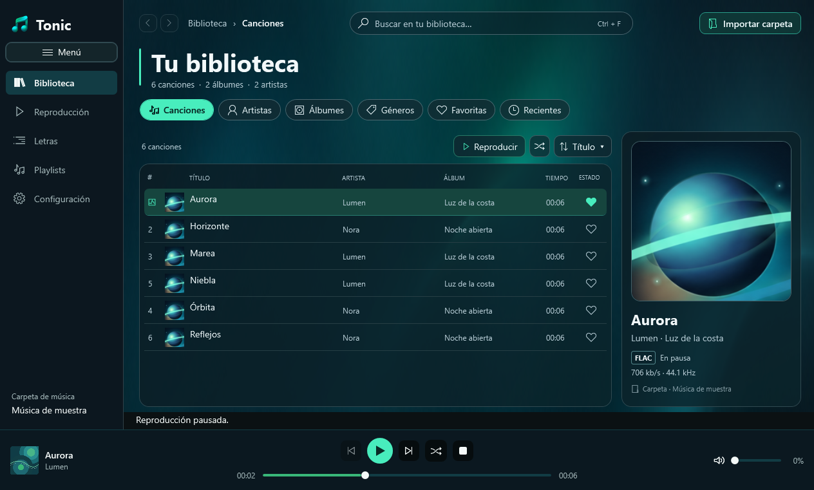
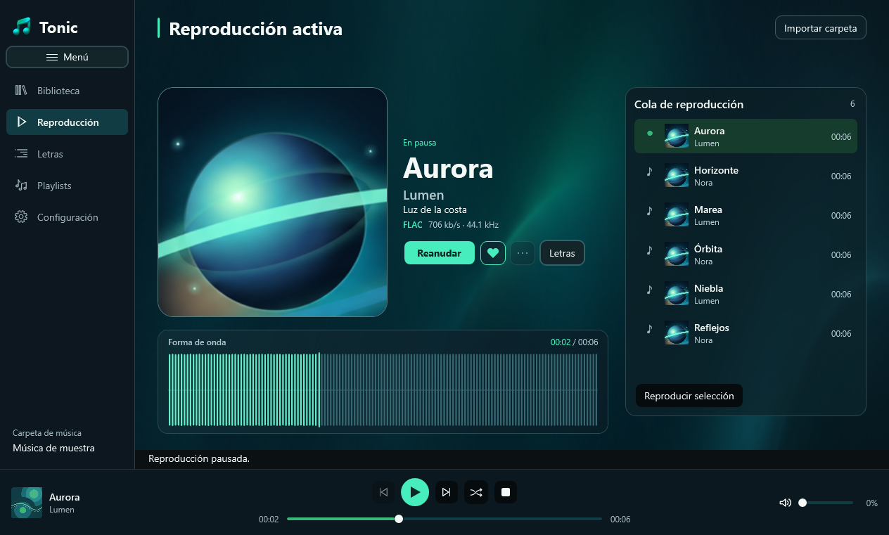
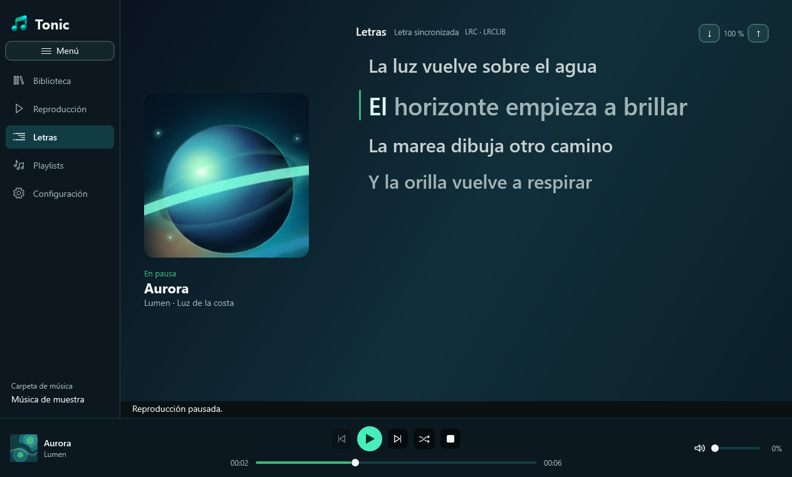
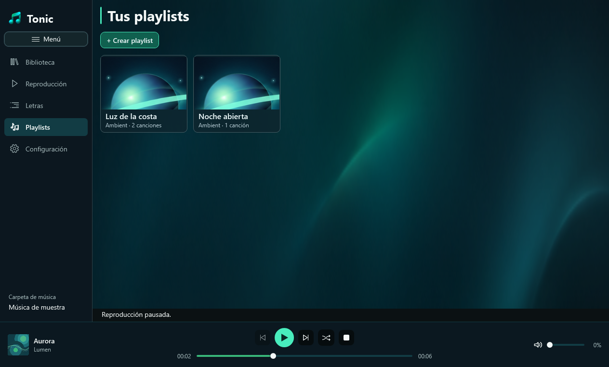
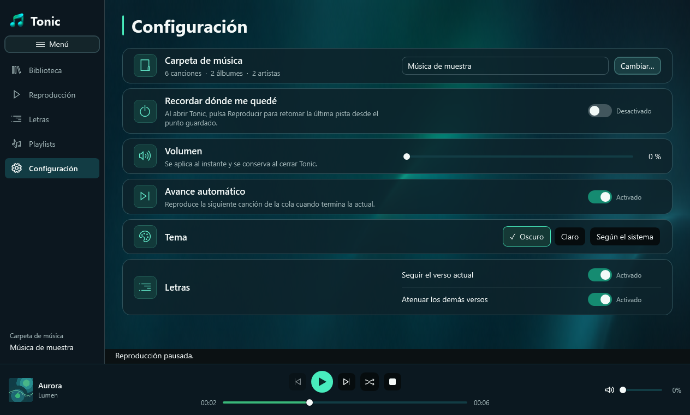
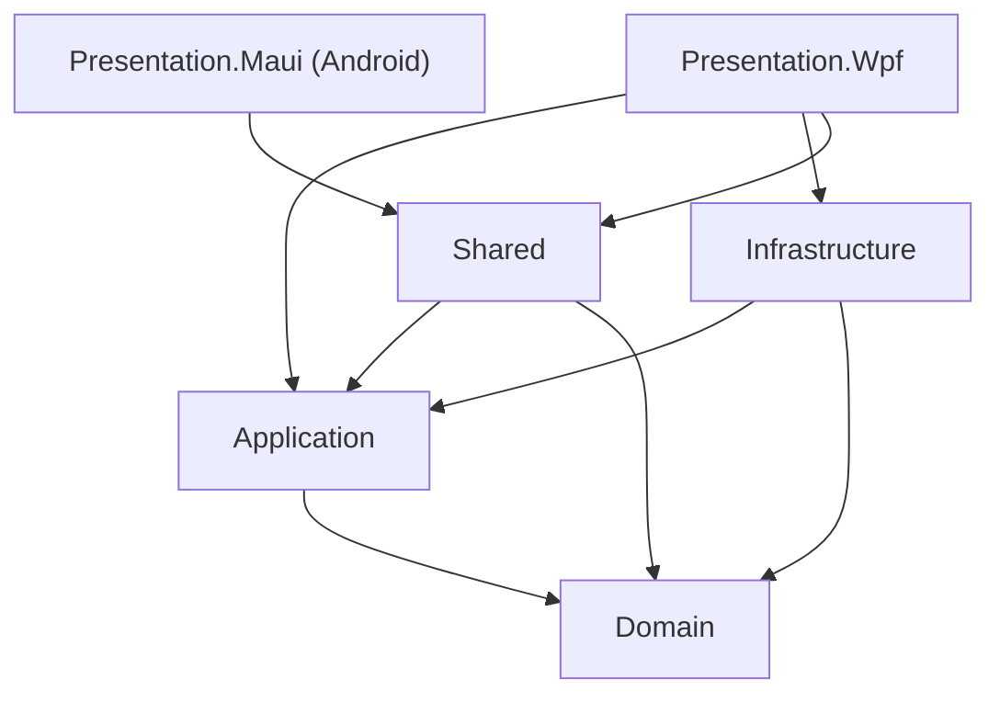

# Tonic

Reproductor de música de escritorio para Windows, desarrollado en C# con WPF y organizado en capas. El repositorio de preferencias locales usa SQLite.

## Capturas



| Reproducción | Letras |
| --- | --- |
|  |  |

| Playlists | Configuración |
| --- | --- |
|  |  |

## Funciones

- **Biblioteca.** Importa carpetas con archivos MP3, WAV y FLAC. Busca por título, artista, álbum o género, consulta las carátulas y organiza las pistas por categorías.
- **Favoritas.** Marca o quita canciones desde Biblioteca y Reproducción. La categoría Favoritas muestra las pistas marcadas de la carpeta actual.
- **Reproducción.** Controla la cola, el volumen y la posición. Reproducción muestra la carátula, los metadatos y una forma de onda cuando hay espacio. Las flechas cruzadas activan el modo aleatorio para la cola de la biblioteca o de una playlist.
- **Letras.** Lee archivos `.lrc` locales y usa LRCLIB como respaldo. Sigue el verso activo, ilumina las palabras progresivamente y permite ajustar el tamaño del texto.
- **Playlists.** Crea listas con nombre y, si quieres, añade género, descripción y portada JPG o PNG. Puedes editar la lista, reordenar sus canciones y reproducirlas en ese orden.
- **Configuración.** Cambia la carpeta y el volumen, controla el avance automático y ajusta el seguimiento y la atenuación de los versos. Puedes activar **Recordar dónde me quedé**.

## Arquitectura

Las flechas indican referencias directas entre proyectos. El arranque de WPF registra los adaptadores de Infrastructure y los lectores de metadatos de Shared para los contratos de Application.



| Proyecto | Responsabilidad |
| --- | --- |
| `MusicLayer.Domain` | Entidades y reglas de la biblioteca y reproducción. |
| `MusicLayer.Application` | Casos de uso y contratos entre capas. |
| `MusicLayer.Shared` | ViewModels, lectura de metadatos y carátulas mediante TagLibSharp. |
| `MusicLayer.Infrastructure` | Escaneo de archivos, audio para Windows, caché de letras y persistencia SQLite. |
| `MusicLayer.Presentation.Wpf` | Aplicación de escritorio y presentación WPF. |
| `MusicLayer.Presentation.Maui` | Biblioteca de Android, selección de archivos y miniaturas de carátulas. |
| `MusicLayer.Domain.Tests` | Pruebas de reglas de dominio. |
| `MusicLayer.Application.Tests` | Pruebas de casos de uso. |
| `MusicLayer.Infrastructure.Tests` | Pruebas de escaneo, audio, metadatos y persistencia local. |
| `MusicLayer.Presentation.Tests` | Pruebas del ViewModel. |

### Base para .NET MAUI

`MusicLayer.Shared` usa `net10.0` y referencia los modelos de Domain y los contratos y casos de uso de Application. WPF le suministra el decodificador de carátulas. La app Android reutiliza el navegador de la biblioteca y los lectores de TagLibSharp.

```powershell
dotnet build .\src\MusicLayer.Shared\MusicLayer.Shared.csproj
```

### Biblioteca para Android

En Android de 64 bits, versión 7.0 o posterior, abrí **Tonic → Elegir canciones** y seleccioná uno o varios MP3, WAV o FLAC. La selección reemplaza la biblioteca de la sesión. Podés buscar por título, artista o álbum. Si falta el título, se muestra el nombre del archivo. Una nota musical identifica las pistas sin portada legible.

Con el SDK de .NET 10, la carga `maui-android`, el SDK de Android y un JDK compatible, podés generar una APK de prueba desde la raíz del repositorio:

```powershell
dotnet build .\src\MusicLayer.Presentation.Maui\MusicLayer.Presentation.Maui.csproj -c Debug
```

Para instalarla en el teléfono, usá el archivo `com.musiclayer.tonic-Signed.apk` de `bin/Debug/net10.0-android/` del proyecto MAUI. La reproducción y la recuperación de la biblioteca al reiniciar corresponden a las siguientes tareas.

Si instalaste las herramientas en `C:\Android`, añadí `-p:AndroidSdkDirectory=C:/Android/Sdk -p:JavaSdkDirectory=C:/Android/jdk` al comando de compilación.

## Plan de trabajo

1. **Sprint 1 — Base y primer sonido:** solución, capas, contratos, escaneo de carpetas y reproducción inicial.
2. **Sprint 2 — Control de reproducción:** cola, pausa, siguiente/anterior, volumen, liberación de recursos y pruebas.
3. **Sprint 3 — Interfaz y MVP:** ventana WPF, controles, progreso, trabajo fuera del hilo de UI y errores visibles.
4. **Sprint 4 — Pulido y entrega.** Metadatos y carátulas de MP3, WAV y FLAC, preferencias en SQLite y restauración de la biblioteca y el volumen al abrir.

Al abrir, Tonic vuelve a escanear la última carpeta importada correctamente y espera a que inicies la reproducción. Si la carpeta se movió o perdió sus permisos, puedes elegir otra.

## Decisiones iniciales

- Aplicación de escritorio Windows con WPF y .NET 10.
- NAudio reproduce el audio. TagLibSharp lee las etiquetas de texto de los formatos compatibles y sus carátulas incrustadas.
- Tonic crea `%LocalAppData%\MusicLayer\preferences.db` con `Microsoft.Data.Sqlite`. Allí guarda la carpeta, el volumen, los ajustes de reproducción y letras, las playlists con sus portadas y las favoritas. Las favoritas se identifican por la ruta del archivo y se conservan aunque importes otra carpeta.
- Domain y Application no dependerán de WPF, SQLite ni de la implementación concreta del audio.

## Empezar

Usa Windows con el SDK de .NET 10. Desde la carpeta donde tienes `MusicLayer.sln`, ejecuta estos comandos. La primera restauración descarga las dependencias desde NuGet.

```powershell
dotnet build MusicLayer.sln
dotnet test MusicLayer.sln
dotnet run --project src/MusicLayer.Presentation.Wpf
```

También puedes abrir `MusicLayer.sln` en Visual Studio con la carga de trabajo de desarrollo de escritorio de .NET.

## Uso

Pulsa **Importar carpeta** en Biblioteca. Usa **Ctrl+F** para buscar. Haz doble clic en una fila o pulsa **Enter** para escucharla. **Reproducir** en Biblioteca inicia la primera pista visible. Su botón **Reproducir una pista al azar** elige una de las pistas visibles. **Recientes** muestra las pistas reproducidas durante la sesión.

Con el reproductor detenido, selecciona un MP3, WAV o FLAC para ver su carátula en el panel. Tonic prefiere la imagen marcada como portada frontal. Si esa etiqueta falta, usa la primera imagen incrustada disponible. Durante la reproducción y la pausa, el panel y la barra inferior muestran la portada de la pista activa aunque selecciones otra fila. Si falta una portada legible, el panel de Biblioteca muestra el planeta del diseño de referencia.

Abre **Reproducción** para ver la pista activa y su cola. Si falta el título, Tonic muestra el nombre del archivo. Todas las vistas comparten la barra inferior. Su botón central permite reproducir, pausar y reanudar desde la misma posición. **Reproducir selección** inicia la pista elegida en la cola.

Abre **Letras** durante la reproducción o la pausa. Puedes pulsar un verso sincronizado para saltar a su comienzo y usar **↑** o **↓** para ajustar el texto entre 80 % y 160 %. Si desplazas los versos manualmente, el seguimiento vuelve al verso activo después de unos segundos cuando está habilitado. Las letras sin sincronizar se desplazan manualmente. La vista avisa si la pista es instrumental, si falta la letra o si el servicio está temporalmente indisponible.

Para usar una letra propia, guarda el archivo `.lrc` en la misma carpeta y con el mismo nombre base que el audio. Por ejemplo, `Canción.flac` y `Canción.lrc`. Tonic lee ese archivo al abrir **Letras**, incluso si el audio carece de etiquetas.

Si falta una letra local válida, Tonic revisa la caché en `%LocalAppData%\MusicLayer\LyricsCache`. Si necesita consultar LRCLIB, usa el título y artista de las etiquetas, junto con el álbum y la duración disponibles. Una letra ya guardada para esa versión se puede leer sin conexión. Al cambiar de canción o de vista, la consulta pendiente se cancela.

Usa **Anterior** y **Siguiente** para recorrer la cola de la carpeta o playlist. Al activar las **flechas cruzadas** de la barra inferior, **Siguiente** y el avance automático eligen otra canción al azar dentro de esa cola. Con las flechas desactivadas, el avance sigue el orden de la lista.

**Detener** corta el audio y libera el archivo, incluso cuando está en pausa. La cola conserva la posición para seguir navegando con **Anterior** y **Siguiente**.

Usa **Volumen** para ajustar el sonido de 0 a 100 antes o durante la reproducción. **0** silencia el audio sin detenerlo. Tonic recupera el último volumen aplicado al volver a abrir. En el primer arranque, el volumen empieza en 100.

Si activas **Recordar dónde me quedé** en Configuración, Tonic selecciona la última pista al reabrir. Pulsa **Reproducir** para retomarla desde el punto guardado. El tema activo es Oscuro. Las opciones Claro y Según el sistema están previstas para futuras versiones.

Haz clic en la **barra de progreso** o arrastra el control y suéltalo para adelantar o retroceder. También puedes darle foco con **Tab** y usar las flechas. El verso activo se actualiza al aplicar el salto. Si saltas en pausa, pulsa **Reanudar** para continuar desde el nuevo punto. La barra vuelve a cero al detener o finalizar.

El escaneo incluye subcarpetas, omite las carpetas sin permisos de acceso y evita enlaces de sistema de archivos. La decodificación usa los códecs de Media Foundation de Windows.

Al importar una carpeta, Tonic muestra cuántas canciones encontró. Si la carpeta está vacía o solo contiene otros formatos, **Elegir carpeta** permite probar con otra. Si falla la lectura de la carpeta elegida, la biblioteca anterior sigue disponible. Ante un error de reproducción, **Elegir otra canción** devuelve el foco a la lista para seleccionar una pista con el teclado o el ratón.

## Validación en Windows

La versión documentada compiló en una copia local con el SDK de .NET 10.0.300, con cero errores y advertencias. Pasaron las 134 pruebas xUnit.

Puedes hacer el recorrido desde tu copia local del proyecto. Para reconstruir los archivos de compilación, ejecuta `dotnet clean MusicLayer.sln` antes de los comandos de **Empezar**.

1. Importa una carpeta con MP3, WAV y FLAC. Comprueba los metadatos, las carátulas y la imagen de respaldo en una pista sin portada.
2. Escucha los tres formatos y prueba pausa, reanudación y saltos desde la barra de progreso y desde un verso sincronizado.
3. Abre una canción conocida sin `.lrc` local, compara la letra de LRCLIB con el audio y vuelve a abrirla sin conexión para comprobar la caché.
4. Cambia el volumen y reinicia Tonic. Comprueba que recupera la biblioteca y el volumen. Si la carpeta guardada se movió, comprueba que puedes importar otra.

Para completar la validación manual quedan la escucha en un dispositivo de audio, la consulta real a LRCLIB con su prueba de caché sin conexión y la revisión a DPI alto. Si tienes una pantalla táctil, comprueba también el arrastre de la barra de progreso.
